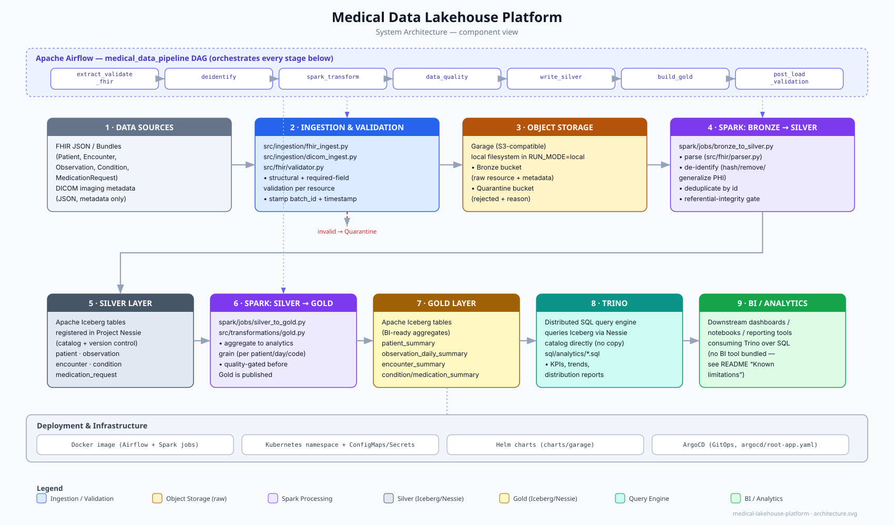
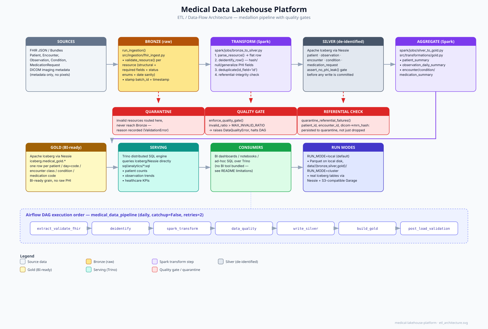
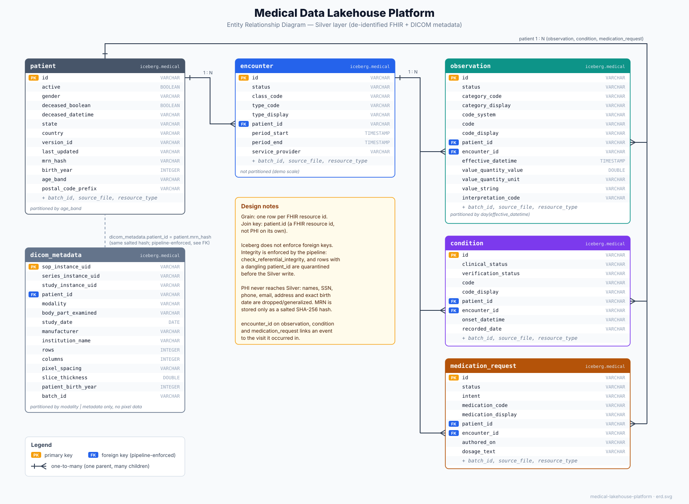
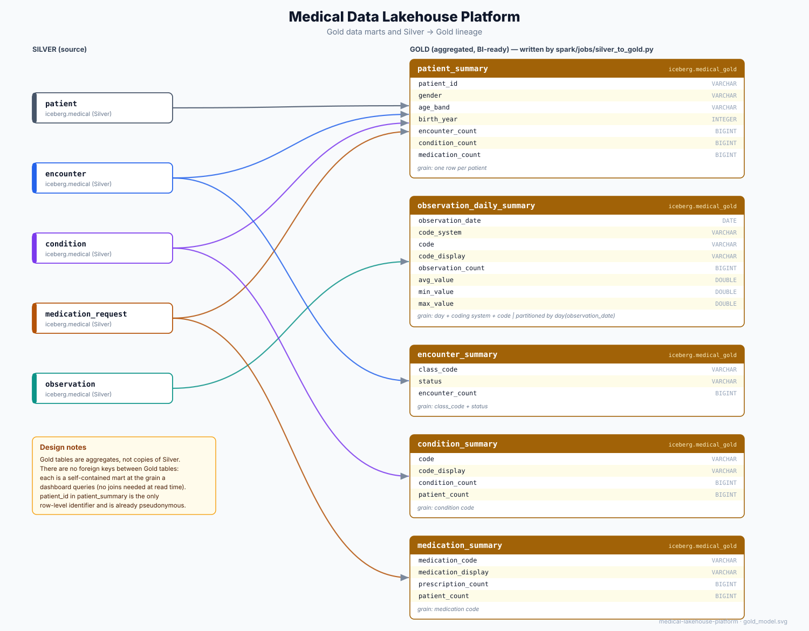

# Medical Data Lakehouse Platform

A working, end-to-end Data Engineering portfolio project: FHIR ingestion,
validation, de-identification, Spark transformation, data quality gating,
and Iceberg/Nessie/Trino-based analytics, orchestrated by Airflow, with
Kubernetes/Helm/ArgoCD as the deployment layer.

This README describes what is **actually implemented and tested** in this
repository. Where something is a documented pattern rather than a deployed,
verified capability, that is called out explicitly under "Known
limitations" -- this project deliberately does not claim more than it does.

---

## 1. Project overview

A hospital-style system generates FHIR resources (patients, encounters,
observations, conditions, medication orders) and DICOM imaging metadata.
This project ingests that data, proves it's valid, strips/generalizes the
PHI it contains, transforms it at scale with Spark, checks its quality, and
lands it in an Iceberg lakehouse that Trino (and, downstream, a BI tool) can
query -- all orchestrated by Airflow and deployable to Kubernetes.

## 2. Business problem

Healthcare organizations need to turn raw clinical data (FHIR feeds, DICOM
studies) into de-identified, analytics-ready datasets for population health,
utilization, and operational reporting -- without ever exposing PHI to
downstream analytics users, and with an auditable, reproducible pipeline
rather than ad-hoc scripts.

## 3. Architecture

```
FHIR JSON / Bundle
      |
      v
Python ingestion  (src/ingestion/fhir_ingest.py)
      |  validate -> stamp metadata -> route
      v
Bronze layer (raw, per-resource JSON + ingestion metadata)
      |
      v
Object storage (Garage, S3-compatible; local filesystem in RUN_MODE=local)
      |
      v
Airflow DAG (dags/medical_data_pipeline.py)
      |
      v
De-identification (src/deidentification/deidentify.py)
      |
      v
Spark transformation (spark/jobs/bronze_to_silver.py)
      |  parse -> de-identify -> deduplicate -> quality-gate
      v
Silver layer (Apache Iceberg tables, registered in Project Nessie)
      |
      v
Trino (SQL query engine over Iceberg/Nessie)
      |
      v
Gold layer (spark/jobs/silver_to_gold.py -- BI-ready aggregates)
      |
      v
BI / dashboards (Trino SQL -- see sql/analytics/; no BI tool is bundled, see limitations)
```

Rendered diagrams (component architecture and ETL/medallion data flow, including
the quality-gate/quarantine branches) are in `docs/diagrams/`:

* `docs/diagrams/architecture.svg` -- system architecture (component view)
* `docs/diagrams/etl_architecture.svg` -- ETL / data-flow architecture (medallion pipeline)





Data model (ERD for the Silver layer, and Gold marts with Silver -> Gold lineage),
plus the comprehensive platform documentation in **[docs/Medical-Lakehouse-Platform-Documentation.pdf](file:///home/haleemo/Downloads/medical-lakehouse-platform/docs/Medical-Lakehouse-Platform-Documentation.pdf)** and written design in **[docs/SYSTEM_DESIGN.md](file:///home/haleemo/Downloads/medical-lakehouse-platform/docs/SYSTEM_DESIGN.md)**:





## 4. Technologies

Python, Apache Airflow, Apache Spark (PySpark), Apache Iceberg, Project
Nessie, Trino, Garage (S3-compatible object storage), Kubernetes, Helm,
ArgoCD, Docker, SQL, pandas, pytest, ruff, GitHub Actions.

## 5. Data flow

See Architecture above. Concretely, for the bundled sample data: FHIR bundle
files in `data/sample/fhir/` are ingested into `data/bronze/<batch_id>/`
(and invalid resources into `data/quarantine/<batch_id>/`), then
`spark/jobs/bronze_to_silver.py` parses + de-identifies + deduplicates them
into `data/silver/<batch_id>/<table>/` (Parquet locally; Iceberg tables in
`iceberg.medical.*` in cluster mode), then `spark/jobs/silver_to_gold.py`
aggregates Silver into `data/gold/<batch_id>/<table>/` (`iceberg.medical_gold.*`
in cluster mode).

## 6. Repository structure

```
medical-lakehouse-platform/
├── dags/medical_data_pipeline.py     # Real Airflow DAG (7 tasks, retries, quality gates)
├── src/
│   ├── ingestion/      # FHIR + DICOM ingestion (validate, stamp metadata, route)
│   ├── fhir/           # FHIR R4 validator + parser (5 resource types)
│   ├── deidentification/  # Real PHI transforms (hash/remove/generalize)
│   ├── quality/        # Required-field, duplicate, date, referential-integrity, PHI-leak checks
│   ├── transformations/ # Gold-layer aggregation logic (pandas, unit tested)
│   ├── storage/        # S3-compatible client with local-filesystem fallback
│   └── utils/          # Config loader (env-var driven) + structured JSON logging
├── spark/jobs/          # bronze_to_silver.py, silver_to_gold.py (real PySpark jobs)
├── data/sample/         # Sample FHIR bundles + DICOM metadata (checked in)
├── data/{raw,bronze,silver,gold,quarantine}/  # Generated at runtime (gitignored)
├── sql/{bronze,silver,gold,analytics}/  # Iceberg DDL + example Trino queries
├── tests/               # pytest: unit + integration + DAG import tests
├── docker/Dockerfile.airflow
├── docker-compose.yml
├── charts/garage/       # Garage S3 Helm chart (fixed: PVC, Secret, probes)
├── k8s/                 # Plain manifests: namespace, ConfigMap, Secret example, Spark Job template
├── argocd/              # GitOps Application manifests
├── scripts/             # init/run/test/backup helper scripts
├── config/              # garage.toml, trino catalog properties, spark-defaults.conf
├── .env.example
├── requirements.txt / requirements-dev.txt
└── .github/workflows/ci.yml
```

## 7. Local setup

```bash
git clone <this-repo>
cd medical-lakehouse-platform
./scripts/init_local_env.sh      # creates .env, a venv, installs deps, creates data/ dirs
source .venv/bin/activate
./scripts/run_pipeline_local.sh  # ingest -> Bronze -> Spark Silver -> Spark Gold, all local
```

No Docker, Kubernetes, S3, or Spark cluster is required for this -- `RUN_MODE=local`
(the default) uses the local filesystem under `data/` and PySpark's `local[*]`
master. A JDK (11 or 17) must be installed for the Spark jobs; everything
else is pure Python.

### A note on Python versions -- especially Python 3.14

`requirements.txt` pins `pyspark>=3.5,<4.0`. That line was never tested
against Python 3.14: Spark only added official Python 3.14 support in
**4.1.0** (`SPARK-51169`), which also bumped Spark's *minimum* supported
Python to 3.10 and needed a newer `cloudpickle` for 3.14 specifically
(`SPARK-54269`). On Python 3.14, `pip install pyspark==3.5.x` will often
appear to succeed (its packaging metadata only declares `>=3.8`, no upper
bound) and then fail later, inside Spark's job-serialization layer, with an
opaque error when `spark/jobs/bronze_to_silver.py` or `silver_to_gold.py`
actually runs.

One specific failure in that family **was reproduced and fixed** here: on
Python 3.12+ (stdlib `distutils` removed per PEP 632),
`pyspark/sql/pandas/utils.py` still does
`from distutils.version import LooseVersion` at import time, so anything
touching pandas<->Spark conversion -- which `silver_to_gold.py` /
`src/transformations/gold.py` does -- raised
`ModuleNotFoundError: No module named 'distutils'`, confirmed by actually
running the test suite on Python 3.12. `requirements.txt` now pins
`setuptools<81`, which keeps setuptools' bundled `_distutils` shim active and
resolves it; `./scripts/run_tests.sh` is green on Python 3.12 with the pin
in place. This fix does *not* by itself confirm Python 3.14 works end to
end -- 3.14 is far enough ahead of what pyspark 3.5.x was built and tested
against (see the cloudpickle point above) that other, harder-to-predict
failures are still plausible. Treat Python 3.11 as the known-good path below
and 3.12/3.13 as "the one confirmed issue is fixed"; 3.14 is not recommended
until this project is verified against pyspark 4.1+.

`./scripts/init_local_env.sh` now checks for this: it looks for
`python3.11`, `python3.12` or `python3.13` on `PATH` (in that order) and
builds `.venv` from the first one it finds, instead of trusting whatever
`python3` happens to point to. If none is found it stops with instructions
rather than silently building a venv likely to break at the Spark step.

If your only Python is 3.14+ (as on a fresh machine), install 3.11
alongside it -- this does not touch or remove 3.14:

```bash
# macOS
brew install python@3.11

# Ubuntu/Debian
sudo add-apt-repository ppa:deadsnakes/ppa && sudo apt update
sudo apt install python3.11 python3.11-venv

# Windows
winget install Python.Python.3.11
# then use `py -3.11` in place of `python3` below
```

then run `./scripts/init_local_env.sh` as usual (or, on Windows,
`py -3.11 -m venv .venv` followed by the same `pip install` steps).

**If you want to stay on Python 3.14 instead:** relax the pin in
`requirements.txt` to `pyspark>=4.1` and `pip install -r requirements-dev.txt`
again. This has not been run against this repo's Spark code in this
environment (no JDK/network access to verify) -- Spark 4.x removed some
deprecated RDD/SQL APIs, so treat it as untested and re-run
`./scripts/run_tests.sh` plus a full `./scripts/run_pipeline_local.sh` before
trusting the output.

## 8. Docker setup

```bash
cp .env.example .env   # fill in AIRFLOW_FERNET_KEY, AIRFLOW_DB_PASSWORD, etc.
docker compose up -d
# Airflow UI:   http://localhost:8080
# Trino:        http://localhost:8081
# Garage S3:    http://localhost:3900
# Nessie API:   http://localhost:19120
```

See the honesty note at the top of `docker-compose.yml`: this compose file
follows each project's documented patterns but was not run end-to-end inside
the sandboxed environment this repo was built in (no Docker daemon there).
The pipeline logic itself is verified independently (see "Tested" below).

## 9. Kubernetes setup

```bash
kubectl apply -f k8s/namespace.yaml
kubectl apply -f k8s/configmap.yaml
cp k8s/secret.example.yaml k8s/secret.local.yaml   # fill in real values, do NOT commit
kubectl apply -f k8s/secret.local.yaml
helm install garage ./charts/garage -f charts/garage/values.yaml \
  --set garage.rpcSecret=$(openssl rand -hex 32) \
  --set garage.adminToken=$(openssl rand -hex 32)
# Then apply the ArgoCD Applications (see argocd/root-app.yaml) or continue
# installing Nessie/Trino/Airflow via their own Helm charts directly.
```

`helm lint`/`helm template` were not run against `charts/garage` in this
sandboxed session (no `helm` binary available); the templates were reviewed
manually for consistency instead. Please run `helm lint` yourself before
deploying.

## 10. Airflow DAG

`dags/medical_data_pipeline.py` implements:

```
extract_validate_fhir -> deidentify -> spark_transform -> data_quality
    -> write_silver -> build_gold -> post_load_validation
```

- `extract_validate_fhir` calls `src.ingestion.fhir_ingest.run_ingestion`,
  which validates every resource and routes invalid ones straight to
  quarantine; the task fails (raises `DataQualityError`) if the batch's
  invalid ratio exceeds `MAX_INVALID_RATIO`.
- Every task has `retries=2`, `retry_delay=5 minutes`, and a 1-hour
  `execution_timeout` (see `DEFAULT_ARGS`).
- The DAG contains almost no business logic itself -- every task calls into
  the reusable, independently unit-tested `src/` modules or shells out to
  the `spark/jobs/` entrypoints, which is what makes the pipeline testable
  outside of Airflow (see `scripts/run_pipeline_local.sh`, which runs the
  exact same steps without Airflow at all).
- Schedule (`MEDICAL_PIPELINE_SCHEDULE`, default `@daily`) and the FHIR
  source directory (`FHIR_SOURCE_DIR`) are environment-variable driven, not
  hardcoded.

Verified: `tests/test_dag_import.py` imports the DAG with a real Airflow
installation, asserts there are no import errors, checks the exact 7-task
dependency chain, and checks every task has retries configured.

## 11. FHIR ingestion

`src/ingestion/fhir_ingest.py` reads FHIR JSON/Bundle files, validates each
resource (`src/fhir/validator.py` -- supported types: Patient, Observation,
Encounter, Condition, MedicationRequest; required fields per type; a few
value-level sanity checks like valid status codes and parseable dates),
stamps `ingestion_timestamp` / `source_file` / `batch_id`, and writes valid
resources to Bronze and invalid ones to quarantine (with the specific
validation error attached) -- nothing is silently dropped.

`src/fhir/parser.py` flattens each supported resource type's nested FHIR
JSON (CodeableConcept, Reference, Period, ...) into the tabular row shape
used by Silver.

DICOM: `src/ingestion/dicom_ingest.py` parses and validates DICOM
**metadata** (patient/study/series attributes; `data/sample/dicom/sample_dicom_metadata.json`
is the local fixture), de-identifies it via
`src/deidentification/deidentify_dicom_metadata`, and runs in the *same*
`extract_validate_fhir` Airflow task as FHIR ingestion, against a combined
invalid-ratio gate. `spark/jobs/bronze_to_silver.py` then writes it to Silver
as `dicom_metadata` alongside the FHIR tables (see section 14).
**This project processes DICOM metadata rather than medical image pixels** --
full DICOM image processing is out of scope.

## 12. De-identification

Implemented in `src/deidentification/deidentify.py`. Field-by-field policy:

| Field (Patient)        | Treatment                                              |
|-------------------------|---------------------------------------------------------|
| `mrn`                    | Deterministic salted SHA-256 hash -> `mrn_hash`         |
| `ssn`                    | Removed                                                  |
| `first_name`/`last_name` | Removed                                                  |
| `phone` / `email`        | Removed                                                  |
| `address_line` / `city`  | Removed                                                  |
| `postal_code`            | Generalized to 3-digit prefix -> `postal_code_prefix`   |
| `birth_date`             | Generalized to `birth_year` + 10-year `age_band` (90+ capped) |
| `gender`, `state`, `country` | Kept (low re-identification risk on their own)     |
| `id` (FHIR resource id)  | Kept unchanged -- see note below                        |

For DICOM: `patient_name` removed, `patient_id` hashed, `patient_birth_date`
generalized to `patient_birth_year` only.

**Join-key note**: `patient_id` references on Observation/Encounter/Condition/
MedicationRequest are left unchanged (not hashed), because `Patient.id`
itself is also left unchanged -- it's an internal FHIR resource id, not a
Safe-Harbor identifier. Hashing one side of a foreign key and not the other
silently breaks every join; this exact bug was caught during development by
the referential-integrity quality check and fixed (see `CHANGELOG.md`).
DICOM is the one place a reference *is* hashed on both sides: DICOM
`patient_id` (tag 0010,0020, which conventionally holds the MRN) is hashed
with the same salted function as `patient.mrn_hash`, so
`dicom_metadata.patient_id = patient.mrn_hash` -- and, like every other
reference in this pipeline, it's checked:
`spark/jobs/bronze_to_silver.py:quarantine_referential_failures` quarantines
a DICOM record whose hashed `patient_id` matches no `patient.mrn_hash`.

The salt used for MRN hashing comes from `DEID_SALT` (env var / Kubernetes
Secret), never hardcoded. `src.quality.checks.check_no_forbidden_fields` +
`FORBIDDEN_SILVER_FIELDS` assert no raw PHI field ever reaches Silver;
`spark/jobs/bronze_to_silver.py` calls this before every write and raises if
it finds one.

## 13. Data quality

`src/quality/checks.py` implements: required-field-not-null, duplicate-id
detection + deduplication, date validity, referential integrity (foreign key
exists in parent table -- checked for `patient_id` *and* `encounter_id` on
every child table, and for DICOM `patient_id` against `patient.mrn_hash`),
Observation-value sanity (a finalized observation must carry a value), and
the forbidden-PHI-field check above. Every check returns structured
`RowIssue` findings (row index, record id, field, message) rather than
strings to re-parse, which is what lets a caller actually act on a specific
row (see `CHANGELOG.md` round 2 item 4 for what parsing IDs out of strings
cost before this).

`QualityMetrics` tracks total/valid/invalid/duplicate/rejected record
counts; `enforce_quality_gate` raises `DataQualityError` (which fails the
Airflow task) when the invalid ratio exceeds `MAX_INVALID_RATIO` (default
20%). Invalid records -- validation failures *and* referential-integrity
failures alike -- go to quarantine (`src/ingestion/quarantine.py`) with
`source_file`, `record_id`, `error_type`, `error_message`,
`ingestion_timestamp`, and the offending payload: never silently dropped,
and never merely logged.

`src/quality/silver_checks.py` runs the full set above over the actual
Silver Parquet output after the Spark transform (the `data_quality` DAG
task); it is unit tested directly (`tests/test_silver_checks.py`) against
fixtures engineered to fail each check, specifically so a checker that
silently inspects nothing cannot pass by accident again.

## 14. Iceberg / Nessie

DDL is in `sql/silver/` and `sql/gold/`, targeting `iceberg.medical.*` /
`iceberg.medical_gold.*` in the Nessie catalog. Partitioning:
- `patient`: partitioned by `age_band` (a handful of coarse buckets), **not**
  `gender` (the original skeleton's choice) -- gender has too few distinct
  values to meaningfully prune scans.
- `observation`: partitioned by `day(effective_datetime)` -- it's
  event/time-series data and almost every query filters by date range.
- `encounter`/`condition`/`medication_request`: not partitioned at this
  data volume; candidates are documented in `sql/silver/README.md`.

`spark/jobs/common.py`'s `build_spark_session()` configures the Iceberg
`SparkCatalog` with a `NessieCatalog` implementation, pointed at
`NESSIE_URI`/`NESSIE_DEFAULT_BRANCH`/`WAREHOUSE_PATH` -- all environment
variables, no hardcoded paths or credentials.

**Write mode**: in cluster mode, Silver tables are created on first write and
`MERGE INTO ... ON <key>` afterwards (`common.py:upsert_iceberg_table`), so
re-running a batch or delivering a later batch updates/accumulates rows
instead of wiping every earlier batch. Gold is always a full
`createOrReplace()` (`replace_iceberg_table`), which is correct there because
Gold is a full recompute from Silver, not an accumulation. The MERGE path is
unit tested with mocks (`tests/test_iceberg_io.py`) but has not been run
against a live Nessie catalog -- see "Known limitations".

**Known gap**: in `RUN_MODE=local` (used for the sample run and tests),
Silver/Gold are written as plain Parquet, not real Iceberg tables (no Iceberg
JVM classpath dependency needed for local dev/CI). The DDL and the
`build_spark_session()` cluster-mode branch describe the real Iceberg path;
switching `RUN_MODE=cluster` with the Iceberg/Nessie jars available (see
`config/spark-defaults.conf`) uses it. This was not run against a live
Nessie/Iceberg cluster in this sandboxed session.

## 15. Trino

`config/trino/catalog/iceberg.properties` configures the Iceberg connector
against Nessie, with S3 credentials substituted from environment variables
(`${ENV:...}`) rather than hardcoded. `sql/analytics/` has example queries
grouped by topic (see next section). Trino itself was not run in this
sandboxed session (no Docker); the SQL is written directly against the
Iceberg/Trino DDL and syntax-checked in CI (`validate-sql` job), not
executed against a live Trino instance.

## 16. Example SQL queries

See `sql/analytics/`:
- `01_patient_counts.sql` -- total patients, by gender, by age band
- `02_observation_trends.sql` -- daily trends for a given code system + code, most frequent codes
- `03_encounter_statistics.sql` -- by class/status, top utilizers
- `04_condition_distribution.sql` -- most common conditions, co-morbidity count
- `05_medication_statistics.sql` -- most prescribed, polypharmacy signal
- `06_basic_healthcare_kpis.sql` -- ER rate, avg conditions/patient, abnormal-observation rate, polypharmacy count

## 17. Testing

```bash
pip install -r requirements-dev.txt
pytest -v
```

**80 tests, all passing** (74 pass standalone + 1 skipped; +6 DAG tests and
the 1 previously-skipped one run with `apache-airflow` installed -- see
`tests/test_dag_import.py`). Coverage: FHIR parsing (all 5 resource types),
FHIR validation, DICOM ingestion (`tests/test_dicom_ingest.py`, including the
"rejected by its own missing key" regression), de-identification (hashing,
generalization, forbidden-field absence, the FHIR/DICOM join-key
regressions), data quality (every check + the quality-gate threshold), Silver
quality checks against real Parquet fixtures engineered to fail
(`tests/test_silver_checks.py`), Iceberg write-sequencing with mocks
(`tests/test_iceberg_io.py`), Gold aggregation (including the null-group-key
regression), an ingestion integration test against the real sample data, real
PySpark integration tests covering orphan references and idempotent reruns
(`tests/test_spark_jobs.py`, needs a JVM -- skipped without one), and DAG
import/structure tests. `ruff check src/ dags/ spark/ tests/` passes with
zero findings. See `CHANGELOG.md` for the specific defects several of these
tests were written against.

## 18. Troubleshooting

- **`ModuleNotFoundError: No module named 'src'`** -- run commands from the
  repo root, or `export PYTHONPATH=.` first.
- **Spark job fails with a Py4J/JVM error** -- you need a JDK (11 or 17) on
  `PATH`; check with `java -version`.
- **`pyarrow` warnings during `silver_to_gold.py`** -- harmless; install
  `pyarrow>=14` (already in `requirements.txt`) to speed up pandas<->Spark
  conversion and silence them.
- **`apache-airflow` pip install fails / dependency conflicts** -- always
  install it with the official constraints file for your Python version
  (see the comment at the bottom of `requirements.txt`); don't just `pip
  install apache-airflow`.
- **Ingestion batch has a high invalid ratio and the DAG fails** -- that is
  the quality gate (`MAX_INVALID_RATIO`) working as intended; check
  quarantine records under `data/quarantine/<batch_id>/` for the specific
  validation errors.

## 19. Security considerations

- No secrets are committed to this repository (verified by a repo-wide
  pattern scan in CI's `lint-and-test` job, and manually during development
  -- see "Remaining limitations" for what "no secrets" does and doesn't
  cover).
- All credentials (S3 keys, `DEID_SALT`, Garage rpc/admin secrets, Postgres
  passwords) are environment-variable / Kubernetes-Secret driven; see
  `.env.example` and `k8s/secret.example.yaml`.
- Bronze retains raw PHI by design (it's the untouched original record, kept
  for auditability/reproducibility) and should be access-restricted more
  tightly than Silver/Gold, which are de-identified before they're written
  (see section 12).
- `sql/analytics/security_and_access_views.sql` shows an example additional
  restricted view on top of the already-de-identified Silver layer, and
  documents (without implementing) how a real Trino event-listener-based
  audit trail would work.
- **This project is designed with healthcare data security and
  HIPAA-oriented controls in mind. It is not HIPAA compliant, and no
  software project can be by itself** -- actual regulatory compliance
  requires organizational, legal, operational, and infrastructure controls
  well beyond a GitHub repository (signed BAAs, access governance, physical
  security, staff training, incident response, audits, and more).

## 20. Known limitations

This is an honest list, not boilerplate:

- **Docker Compose / Kubernetes / ArgoCD were not deployed end-to-end** in
  the sandboxed environment this repo was built in (no Docker daemon, no
  Docker Hub / Helm-repo network access there). The pipeline *logic* is
  verified independently by running its Python/PySpark entrypoints directly
  in `RUN_MODE=local` (see "Tested" in the project report) -- the
  infrastructure manifests are written carefully and reviewed, but not
  smoke-tested against a live cluster. Please validate with `helm lint` /
  `kubectl apply --dry-run` / a real `docker compose up` before relying on
  them.
- **The Iceberg `MERGE INTO` upsert (section 14) is verified with mocked
  sequencing tests, not a live Nessie/Iceberg catalog.** The
  create-then-merge *logic* is tested; the generated SQL running correctly
  against a real cluster is not. Verify it there before depending on it.
- **`RUN_MODE=local` does not accumulate across batches.** Cluster mode's
  MERGE semantics (section 14) make Silver/Gold cumulative; local mode writes
  one independent Parquet directory per `batch_id` with no merge step. Don't
  use a local run to reason about multi-batch behavior.
- **Local dev mode writes Parquet, not Iceberg.** `RUN_MODE=local` skips the
  Iceberg/Nessie JVM classpath dependency entirely for a fast,
  dependency-light dev loop; `RUN_MODE=cluster` is the real Iceberg/Nessie
  path (see section 14). Date/time columns are plain strings in local mode
  vs. proper `TIMESTAMP` types in the cluster-mode Iceberg DDL -- see
  `sql/silver/README.md`.
- **No distributed Spark cluster is deployed.** The Spark jobs run in
  `local[*]` mode (real PySpark, multi-threaded, not just pandas) and are
  written to also work in cluster mode, but a true multi-node
  Spark-on-Kubernetes / Spark Operator deployment is documented as future
  work (`k8s/spark-job-template.yaml`), not implemented.
- **No BI tool (e.g. Superset) is included.** The original architecture
  sketch mentioned one; it is not implemented here. Gold tables are
  designed to be BI-ready (see `src/transformations/gold.py`), and any tool
  that speaks Trino/SQL can sit on top.
- **Single-node, single-replica everything.** Garage runs with
  `replication_factor=1` and one PVC; Nessie runs in-memory in the compose
  file. This is portfolio/PoC-grade durability and availability, not
  production HA -- see the Helm chart's `values.yaml` comments for what a
  real multi-node deployment would require.
- **Backup is a manual script**, not a scheduled job
  (`scripts/backup_iceberg_warehouse.sh`), and does not cover the Nessie or
  Airflow metadata databases (see the script's own docstring for why).
  Current RPO/RTO = "however often/quickly you run it," which is not
  measured or guaranteed.
- **"No secrets committed" was checked with a pattern-based `grep`** (also
  run in CI), not a dedicated secret-scanning tool (e.g. gitleaks/trufflehog)
  or a full git-history scan -- it catches obvious hardcoded
  password/token/key literals in the current file tree, not everything a
  dedicated scanner would.
- **Nessie/Trino community Helm chart value keys** referenced in
  `argocd/apps/nessie-catalog.yaml` and `trino-query.yaml` for injecting
  secrets were not re-verified against a live chart repository in this
  session (no network access to those chart hosts) -- verify the exact key
  names against the pinned chart version before applying.
- **FHIR validation is pragmatic, not a full profile validator.** It checks
  resource type support, required fields, and a handful of value-level
  rules -- it is not equivalent to validating against the official FHIR
  StructureDefinitions.

## 21. Future improvements

- Wire a real multi-node Spark-on-Kubernetes deployment (Spark Operator) for
  `spark_transform`/`build_gold` instead of the single-pod Job template.
- Add a BI layer (Superset or similar) on top of Trino for the Gold tables.
- Move Nessie/Airflow to a real, backed-up Postgres and extend
  `scripts/backup_iceberg_warehouse.sh` to cover it.
- Multi-node Garage (`replication_factor=3`) for real storage HA.
- A dedicated secret-scanning step in CI (gitleaks/trufflehog) in addition
  to the current pattern-based grep.
- Full FHIR profile validation via a library such as `fhir.resources`.
- Prometheus/Grafana: the structured JSON logs in `src/utils/logging_config.py`
  are already shippable to any log aggregator without a custom parser;
  Spark/Airflow both expose Prometheus-compatible metrics endpoints that
  could be scraped, but no Prometheus/Grafana deployment is included here.

## 22. Changelog

Correctness bugs found after the fact -- some by internal review, some by an
external review that re-ran the pipeline for real (including the DAG, which
had only ever been import-tested) and checked every diagram/doc claim
against the code -- are tracked in **`CHANGELOG.md`**, each with the defect,
the fix, and the regression test written against it. It is not shipped as a
footnote: several of the defects (DICOM never wired into the pipeline, a
dangling-reference check that dropped rows instead of quarantining them, an
Iceberg write mode that would have silently discarded every earlier batch)
were real correctness bugs that a green test suite did not catch, which is
the reason each fix now has a test that fails if the defect comes back.

## How to run (quick reference)

```bash
# Local, no infrastructure:
./scripts/init_local_env.sh
source .venv/bin/activate
./scripts/run_pipeline_local.sh
./scripts/run_tests.sh

# Docker Compose (Airflow + Garage + Nessie + Trino):
cp .env.example .env   # fill in the required values
docker compose up -d

# Kubernetes (Garage chart shown; see section 9 for the rest):
kubectl apply -f k8s/namespace.yaml -f k8s/configmap.yaml
helm install garage ./charts/garage -f charts/garage/values.yaml \
  --set garage.rpcSecret=$(openssl rand -hex 32) --set garage.adminToken=$(openssl rand -hex 32)
```

## 23. Authors & Team Contributions

| Author | Role | GitHub Profile | Primary Contributions |
| :--- | :--- | :--- | :--- |
| **Abdelhaleem Mohammed** | Lead DevOps & GitOps Platform Engineer | [@Haleimo](https://github.com/Haleimo) | Kubernetes IaC, GitHub Actions, GitLab CI Container Registry, ArgoCD Sync Waves & Airflow GitSync Handoff |
| **Mahmoud Saad** | Lead Data Engineer & Pipeline Architect | [@Mahmoud2saad](https://github.com/Mahmoud2saad) | FHIR/DICOM Ingestion, PHI De-identification, Airflow DAG, PySpark Iceberg Jobs & Trino Analytics SQL |

For full itemized contribution details and DataOps collaboration architecture, see **[AUTHORS.md](file:///home/haleemo/Downloads/medical-lakehouse-platform/AUTHORS.md)** and **[docs/DATAOPS_COLLABORATION.md](file:///home/haleemo/Downloads/medical-lakehouse-platform/docs/DATAOPS_COLLABORATION.md)**.

