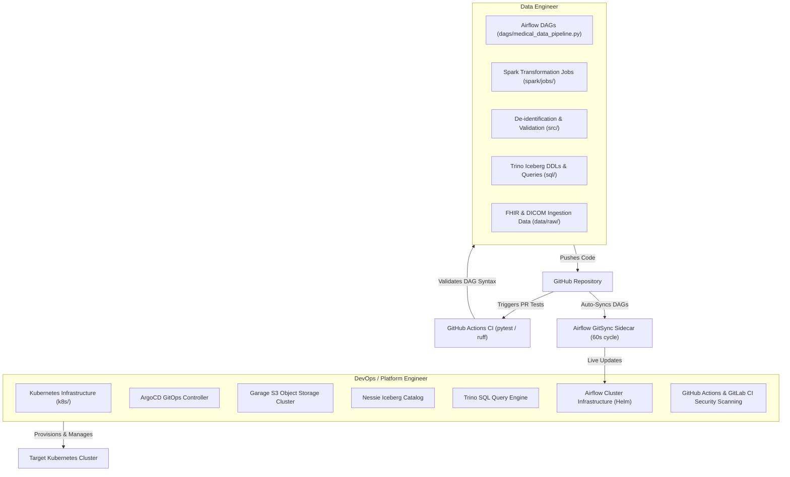

# DataOps Collaboration & Handoff Specification

This document details the **decoupled GitOps & DataOps collaboration strategy** between the **DevOps / Platform Engineer** and the **Data Engineer** for the Medical Data Lakehouse Platform.

---

## 1. Core Collaboration Architecture

To achieve maximum operational independence without sacrificing platform governance, the platform is decoupled into two distinct operational spheres connected by automated **GitSync** and **CI/CD Quality Gates**:



---

## 2. Responsibility Matrix

| Asset Category | File / Path | Primary Owner | DevOps Role | Data Engineer Role |
| :--- | :--- | :---: | :--- | :--- |
| **Kubernetes Configs** | `k8s/` | DevOps | Manages Namespaces, ConfigMaps & Spark Templates | Consumes pre-wired S3/Secret environment variables |
| **Storage Infrastructure** | `charts/garage/`, `argocd/apps/garage-storage.yaml` | DevOps | Provisions S3 cluster, configures PVCs & persistence | Ingests raw data & reads Bronze/Silver/Gold buckets |
| **Catalog & Query Engine** | `argocd/apps/{nessie,trino}.yaml` | DevOps | Deploys Nessie JDBC store & Trino Iceberg connector | Executes SQL DDLs & builds analytical queries in `sql/` |
| **Airflow Orchestrator** | `argocd/apps/airflow-orchestration.yaml` | DevOps | Deploys Airflow engine & configures `gitSync` sidecar | Creates DAGs in `dags/` with zero container redeployments |
| **PySpark & Data Logic** | `spark/jobs/`, `src/` | Data Engineer | Provides base Python/Spark container image & CI runner | Implements PySpark logic, validation, and de-identification |

---

## 3. Data Engineer Handoff Protocol

### Step 1: Local Development & Verification
The Data Engineer can test pipelines locally without needing Kubernetes or cloud infrastructure:
```bash
./scripts/init_local_env.sh
source .venv/bin/activate
./scripts/run_pipeline_local.sh   # Runs ingestion -> Spark Silver -> Spark Gold locally
./scripts/run_tests.sh            # Executes pytest suite & DAG import checks
```

### Step 2: Submitting Pipeline Updates
When the Data Engineer creates a new Airflow DAG or modifies a PySpark transformation:
1. Commit changes to a feature branch and open a Pull Request on GitHub.
2. **GitHub Actions (`.github/workflows/ci.yml`)** automatically triggers:
   * `pytest tests/test_dag_import.py` to confirm zero syntax errors or missing task retries.
   * `ruff` linting and security scans.
3. Once the PR is merged to `main`, Airflow's **GitSync sidecar** automatically pulls the updated DAG files into the running cluster within **60 seconds**.

### Step 3: Direct Data Ingestion Handoff
To upload raw FHIR bundles or DICOM metadata into the lakehouse:
* **Local Mode**: Copy files to `data/sample/fhir/`.
* **Cluster Mode**: Upload data to the Garage S3 `data-lake` bucket under `s3://medical-bronze/raw/` using AWS CLI or S3 tools:
  ```bash
  aws --endpoint-url http://garage.data-lake.svc.cluster.local:3900 \
    s3 cp ./data/sample/fhir/ s3://medical-bronze/raw/ --recursive
  ```

---

## 4. Key Benefits of This Decoupled Model

1. **Zero Infrastructure Downtime**: Data Engineers deploy DAG changes instantly via `gitSync` without redeploying Airflow or building Docker images.
2. **Clear Auditability**: Infrastructure changes follow ArgoCD GitOps, while data logic changes follow Python CI/CD PR reviews.
3. **Seamless Portfolio Presentation**: Clearly showcases both **Infrastructure/DevOps Mastery** (Helm, ArgoCD, GitSync, GitLab CI) and **Data Engineering Rigor** (PySpark, Iceberg, Airflow, FHIR validation).
