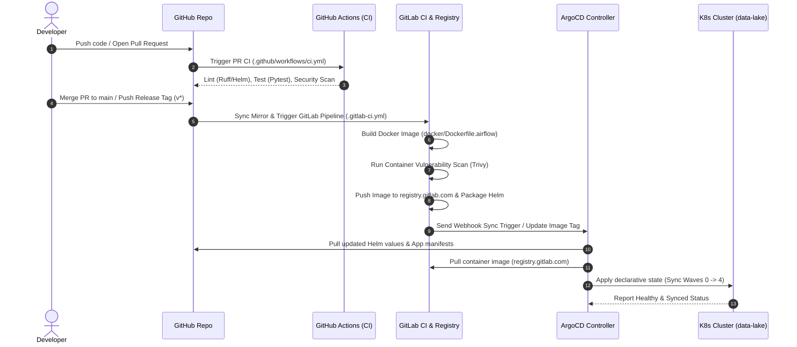

# Enterprise DevOps & GitOps Practice Guide

This document presents the architecture and operational specification for deploying the **Medical Data Lakehouse Platform** using a hybrid **GitHub + GitLab + ArgoCD** GitOps pipeline.

---

## 1. Executive Summary & Core Philosophy

In modern data platform engineering, decoupling **code development**, **security/container assembly**, and **cluster state management** ensures maximum velocity, security, and auditability:

* **GitHub**: Developer Hub & Source Code Management (Application Logic, Airflow DAGs, Helm Charts, ArgoCD Manifests, Code Review/PRs).
* **GitLab**: Container Registry, Enterprise Security Scanning, Heavy Container Build Farm (`.gitlab-ci.yml`), and Helm Package Repository.
* **ArgoCD**: Kubernetes Continuous Delivery Engine operating inside the target cluster using declarative **GitOps** principles (App-of-Apps pattern, automated drift remediation, sync waves).

---

## 2. Platform Architecture Diagram



---

## 3. Tool Matrix & Responsibility Separation

| Tool | Component / Role | Responsibilities | Key Configuration Files |
| :--- | :--- | :--- | :--- |
| **GitHub** | Code Repository & Developer Workspace | Developer PR review, Python unit tests, code linting, Helm syntax check | `.github/workflows/ci.yml`<br>`.github/workflows/deploy-trigger.yml` |
| **GitLab** | Container Build, Registry & Security | Multi-arch Docker builds, Trivy container security scans, GitLab Container Registry (`registry.gitlab.com`), Helm Package Registry | `.gitlab-ci.yml` |
| **ArgoCD** | GitOps Kubernetes Operator | Declarative continuous delivery, auto-healing, prune management, deployment sync waves | `argocd/root-app.yaml`<br>`argocd/apps/*.yaml` |

---

## 4. GitOps Sync Waves & Deployment Hierarchy

To prevent race conditions during infrastructure bootup (e.g. Airflow or Trino starting before storage or metadata catalogs are ready), ArgoCD uses **Sync Waves**:

| Wave | Application Manifest | Components Deployed | Prerequisite |
| :---: | :--- | :--- | :--- |
| **Wave 0** | `argocd/apps/k8s-platform-config.yaml` | Namespace (`data-lake`), ConfigMaps, Secret Templates | Kubernetes API ready |
| **Wave 1** | `argocd/apps/garage-storage.yaml` | Garage S3 Object Storage StatefulSet, PVCs, Services | Wave 0 Synced |
| **Wave 2** | `argocd/apps/nessie-catalog.yaml` | Nessie Catalog Service + PostgreSQL DB Backend | Wave 1 Synced |
| **Wave 3** | `argocd/apps/trino-query.yaml` | Trino Coordinator & Workers with Iceberg Connector | Wave 2 Synced |
| **Wave 4** | `argocd/apps/airflow-orchestration.yaml` | Airflow Webserver/Scheduler pulling image from GitLab | Wave 3 Synced |

---

## 5. Branching Model & Release Strategy

1. **Trunk-Based / Feature Branch Flow**:
   * All feature work occurs on `feature/*` or `fix/*` branches.
   * PRs target the `develop` or `main` branch.
   * GitHub Actions runs pytest matrix (Python 3.11/3.12), Ruff linting, and Helm linting.
2. **Staging / Automated Continuous Deployment**:
   * Merging to `main` triggers automated build and push to `registry.gitlab.com/...:latest`.
   * ArgoCD automatically syncs `main` branch manifests to the Staging environment.
3. **Production Release Strategy**:
   * Production deployments are triggered by Git Semantic Version tags (`v1.2.0`).
   * Tag push builds immutable container image `registry.gitlab.com/...:v1.2.0`.
   * ArgoCD syncs target revision `v1.2.0` with manual/promoted sync approval.

---

## 6. Secrets Management Strategy

Never commit plaintext secrets to Git repositories. Recommended production patterns:

1. **Sealed Secrets (Bitnami)**: Encrypt secrets locally with `kubeseal` public key; commit `.sealed-secret.yaml` safely to GitHub. ArgoCD applies the SealedSecret, and the in-cluster SealedSecrets controller decrypts it into a native Kubernetes Secret.
2. **External Secrets Operator (ESO)**: Connects Kubernetes directly to HashiCorp Vault, AWS Secrets Manager, or GCP Secret Manager.
3. **Pre-created Secrets**: Out-of-band secret creation before ArgoCD app deployment:
   ```bash
   kubectl create secret generic medical-pipeline-secrets \
     --from-literal=DEID_SALT="$(openssl rand -hex 16)" \
     --from-literal=S3_ACCESS_KEY="garage_access_key" \
     --from-literal=S3_SECRET_KEY="garage_secret_key" \
     -n data-lake
   ```

---

## 7. Rollback & Disaster Recovery Runbook

### Automatic Rollback
If a newly deployed container image or configuration fails Kubernetes health probes, ArgoCD automatically halts the sync and marks the application `Degraded`.

### Manual Rollback via ArgoCD CLI / UI
```bash
# Rollback to the previous successful GitOps revision
argocd app rollback airflow-orchestration
```

### Manual Emergency Drift Remediation
```bash
# Force hard re-sync with pruning enabled
argocd app sync medical-lakehouse-root --prune --force
```
